# [Drone Interference Detection] Real-world validation effective! New path for small drone GPS signal deception detection with deep learning - [Python code included]

1. Abstract: The navigation of small unmanned aerial vehicles (UAVs) mainly relies on the Global Positioning System (GPS), but GPS is susceptible to spoofing attacks, leading to the loss of positioning capabilities for UAVs. To address this issue, this paper proposes a deep learning-based method for detecting GPS signal spoofing. Firstly, it elaborates on the acquisition and preprocessing methods of the GPS signal dataset, including the hardware systems of the drones and jammers used in the experiment, the timing and weather conditions of data collection, the use of Spearman's correlation coefficient for preprocessing, and the application of SVM-SMOTE to solve the problem of imbalanced spoofing data. Secondly, it introduces the PCA-CNN-LSTM model: through principal component analysis (PCA) from the GPS signal dataset to extract features related to spoofing; using convolutional neural network (CNN) to extract local features from the dataset; and employing Long Short-Term Memory networks (LSTM) as the subsequent module to further process and model the features. To reduce randomness and chance in simulation experiments, the proposed spoof detection machine learning model was trained and evaluated using a 10-fold cross-validation method. A series of experiments were conducted in numerical simulation environments, and the performance of the proposed model was compared with mainstream traditional machine learning and deep learning models. The results show that the accuracy of the PCA-CNN-LSTM neural network model is the highest, reaching 0.9949, providing theoretical basis and technical support for the detection of GPS signal spoofing in small UAVs.
2. Introduction: Small UAVs typically carry various sensors, among which the GPS receiver is crucial, as it determines the UAV's position, spatial coordinates, and altitude by receiving satellite signals, ensuring precise flight and enhancing task execution capabilities. Therefore, GPS is one of the key technologies for small UAVs. However, GPS signals are susceptible to spoofing attacks, which can severely harm GPS navigation and time synchronization systems, especially prominent in military, aviation, maritime, and public safety fields. Reports of GPS signal spoofing incidents have been reported by Iran, India, and other countries.
To address the issue of GPS signal vulnerability to spoofing in small drones, scholars have employed multipath detection, energy detection, receiver fingerprint recognition, and machine learning-based methods. However, these approaches have significant drawbacks: Multipath detection fails when spoofing is subtle, requiring high-precision clock synchronization and additional hardware support; Energy detection fails when signals are faint and noisy, leading to misclassification of normal signals as spoofed; Receiver fingerprint recognition requires extensive training data and high-end receiver hardware, and is susceptible to environmental changes; Traditional machine learning methods demand high data quality and feature selection.
In contrast, deep learning methods can better capture signal features and extract useful information, allowing for rapid processing and analysis of a large number of GPS signal data, achieving fast spoof detection. Therefore, this paper proposes a GPS signal spoof detection method based on the PCA-CNN-LSTM model, using a composite wing drone and a spoof interference machine as the experimental system, capable of detecting whether a small drone has been spoofed. The main contributions include:
1. 
Proposing a GPS signal spoof detection model based on PCA-CNN-LSTM, consisting of PCA, CNN, and LSTM components, where PCA reduces the dimensionality of GPS signal data, CNN extracts data features, and LSTM models the sequence of CNN outputs.
2. 
Addressing the issue of limited real GPS signal data volume by proposing an SVM-SMOTE model for data expansion of GPS signal data.
3. 
Verifying the accuracy of the PCA-CNN-LSTM model on the GPS signal dataset reaches 0.9943, with precision rate at 0.9798, recall rate at 0.965, and F1 score at 0.9722 in a simulation experiment environment.
III. Brief Introduction to the Network Architecture and Method (I) Network Architecture: PCA-CNN-LSTM Model This model integrates Principal Component Analysis (PCA), Convolutional Neural Network (CNN), and Long Short-Term Memory Network (LSTM), processing GPS signal data in three stages. The architecture flow is as follows:
1  
PCA Dimensionality Reduction Layer: This layer reduces the dimensionality of the preprocessed 36-dimensional GPS signal features. It selects the first 15 principal components (with a cumulative variance contribution rate of 0.9136) by calculating the data covariance matrix, eigenvalues, and eigenvectors. It retains key pseudo-related features and eliminates redundant information, reducing the data dimensionality from 36 to 15, thereby enhancing subsequent model computational efficiency.
2  
CNN Feature Extraction Layer: Using a 1D convolutional structure (adapted for time-series GPS signals), with 8 convolutional kernels of size 1, the convolution results are processed through a PReLU activation function to avoid the "dead neurons" issue of ReLU. Subsequently, a max pooling layer with a pooling size of 1 is applied to reduce dimensionality, extracting local spatial features from the signal and enhancing feature robustness.
3  
LSTM Sequence Modeling Layer: Take the local features outputted by CNN as input, set 50 hidden nodes, employ Tanh activation function, control information flow through input gate, forget gate, and output gate to capture the temporal dependencies of GPS signals (such as the changing patterns of deceived signals over time), and finally output detection results through a fully connected layer (64 nodes, PReLU activation) and an output layer (2 nodes, corresponding to "not deceived" and "deceived").
(II) Core Method 1
Data acquisition and preprocessing
•  
Hardware and Data Collection: Using the Chengdu Zongheng Da Peng CW-10 II composite wing drone (maximum takeoff weight 12kg, endurance 90 minutes, etc.) and the Hunan Matrix Electronic Deception Interference Machine (GPS L1 band, BPSK modulation, operational range 500m, etc.), data collection was completed on December 27-30, 2021, under clear weather conditions with temperatures ranging from -13℃ to 7℃ and wind speeds of no more than level 5. The data collection involved straight/circular flight (including deception scenarios) and yielded a total of 7699 GPS signal data (64-dimensional features), comprising 6914 undeceptive samples (major class) and 785 deceptive samples (minor class).
•  
Data preprocessing: Manually remove irrelevant features (such as drone power voltage and GPS recording time, which are not susceptible to deception); use Spearman rank correlation coefficient to select features (suitable for nonlinear data and outliers), eliminate features with a correlation with deception less than 0.2, ultimately retaining 36 effective features.
•  
Data Augmentation: Utilizing SVM-SMOTE to address data imbalance issues. By employing SVM, misclassified samples on the decision boundary are identified, and synthetic samples are generated in the minority class (deceitful samples) boundary region. This results in a balanced dataset with 6914 deceived samples and 13828 total instances. Subsequently, data is normalized (scaled to [0,1]) to enhance model convergence speed and accuracy.
1  
Model Training and Evaluation
•  
Training settings: Based on the Python 3.6.13 and Keras 2.4.3 framework, training is conducted using a NVIDIA RTX 3090 GPU; the loss function adopts cross-entropy (measures the difference in probability distribution between the predicted and true labels); the optimizer is Adam (learning rate 0.001, employing an exponential decay strategy); with 30 epochs, batch size 2, early stopping is implemented based on the validation set convergence to prevent overfitting.
•  
Evaluation Method: 10-fold cross-validation (dividing the enhanced data into 10 groups, using one group as the test set and nine groups as the training set for each iteration, repeating this process 10 times to average the results). The accuracy, precision, recall, and F1 score are calculated using confusion matrices to evaluate the model's performance.
IV. Conclusion The paper proposes PCA-CNN-LSTM model for GPS signal spoof detection, and the main results and prospects are as follows:
1  
Research findings
•  
A GPS signal dataset was collected in real scenarios using a composite wing drone and a deception jamming machine, combined with SVM-SMOTE to enhance the data. The features were selected by Sperman correlation coefficient and then reduced dimensionality (64→15) through PCA.
•  
Comparing 15 machine learning models (including traditional models such as decision trees, KNN, XGBoost, and deep learning models like MLP, LSTM, GRU), the PCA-CNN-LSTM model has the best performance. After 10-fold cross-validation, its accuracy rate reached 99.43%. The confusion matrix shows that it correctly classified the most samples (TN=689, TP=77), while misclassifying the least samples (FN=3, FP=2).
•  
Deep learning models generally outperform traditional machine learning models due to their ability to learn the features of raw data directly from end-to-end, without the need for manual feature design. They can also capture nonlinear relationships in signals and adapt to complex decoy datasets. The PCA-CNN-LSTM model further enhances detection accuracy by integrating PCA dimensionality reduction, CNN local feature extraction, and LSTM temporal modeling capabilities.
1  
Future Outlook
•  
The current dataset only contains flight paths of straight lines and arcs, and will be designed to include more complex flight paths in the future to expand the dataset and enhance the model's generalization ability.
•  
The current model has high computational and storage requirements, making it difficult to adapt to the hardware of small drones. Methods such as network pruning and quantization for perception training will be implemented to achieve model lightweighting, promoting its deployment in small drone systems.
•
In the future, based on the feature information of deceptive data, more advanced deep learning models and methods will be proposed to further optimize the performance of GPS signal deception detection.

## Images

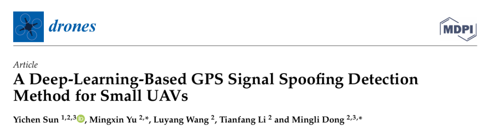
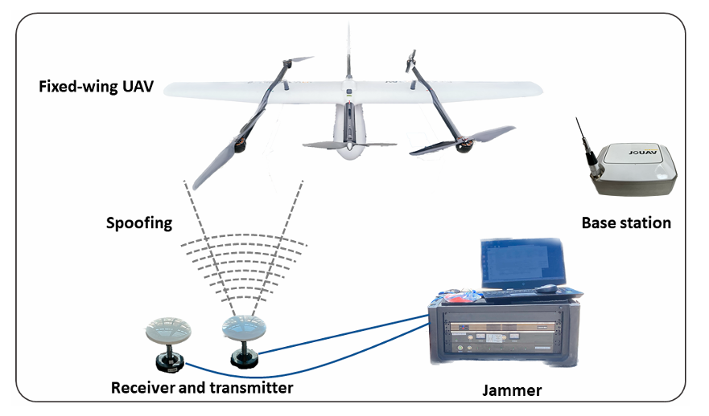
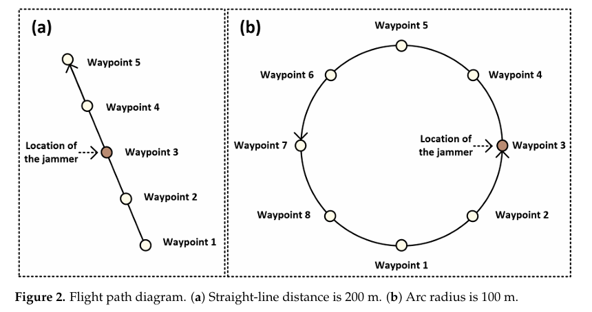
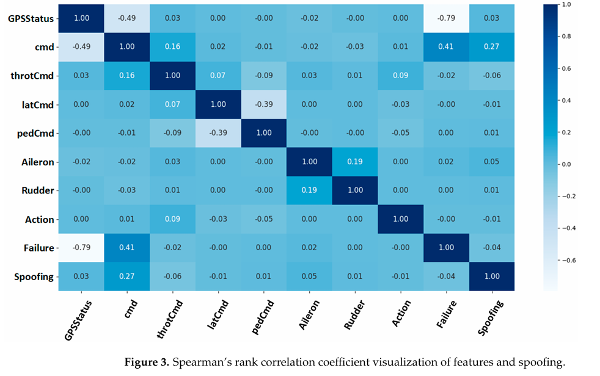
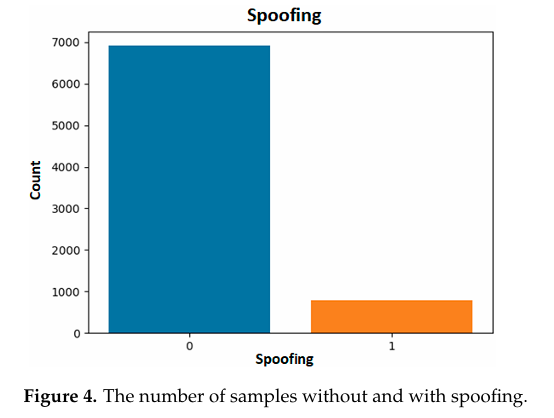
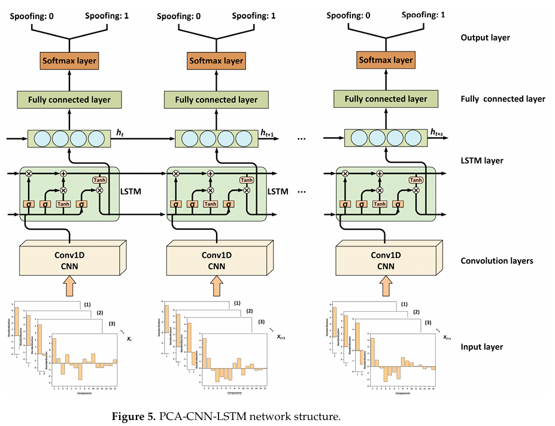
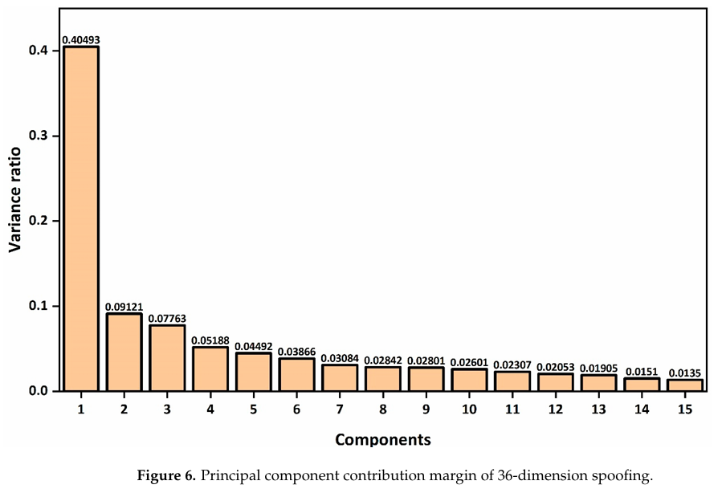
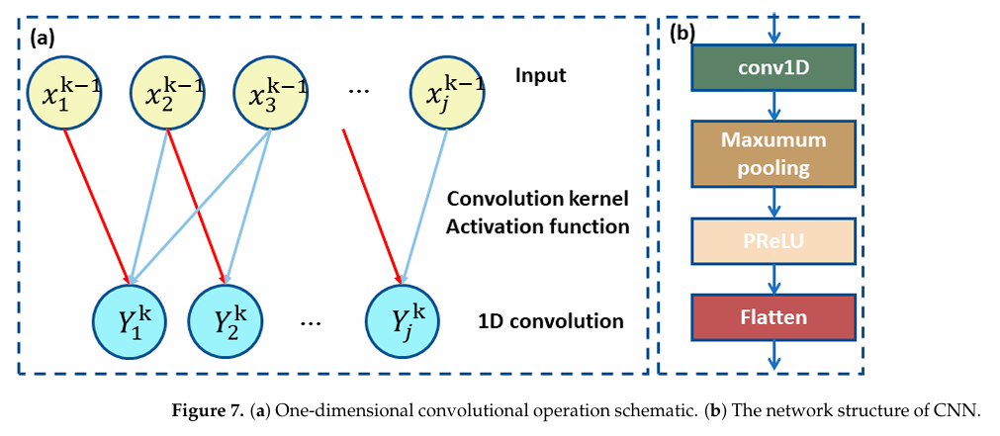
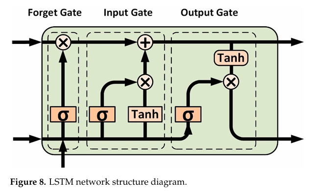
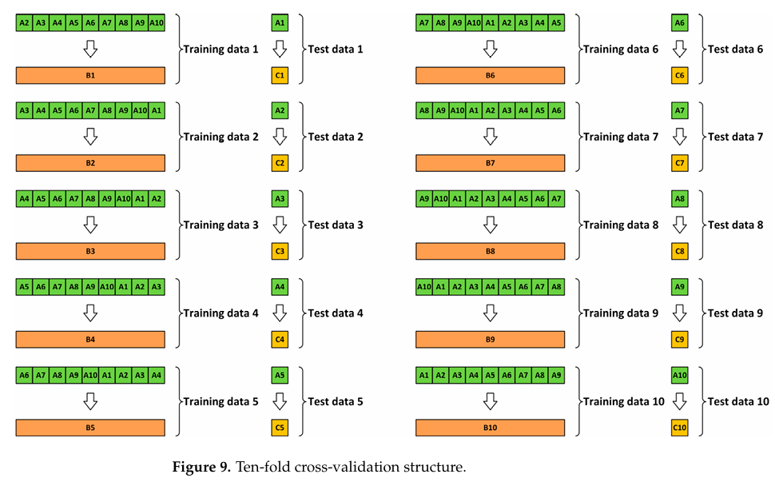
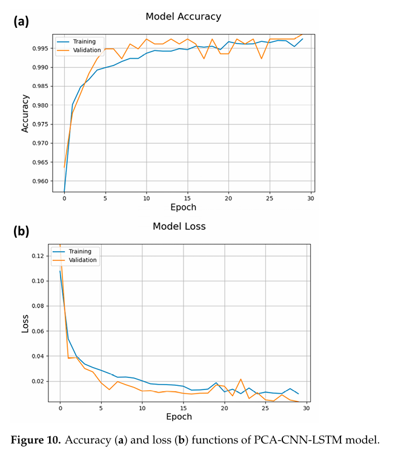
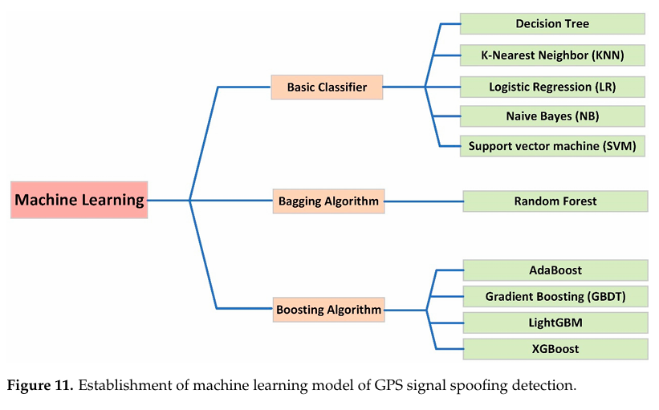
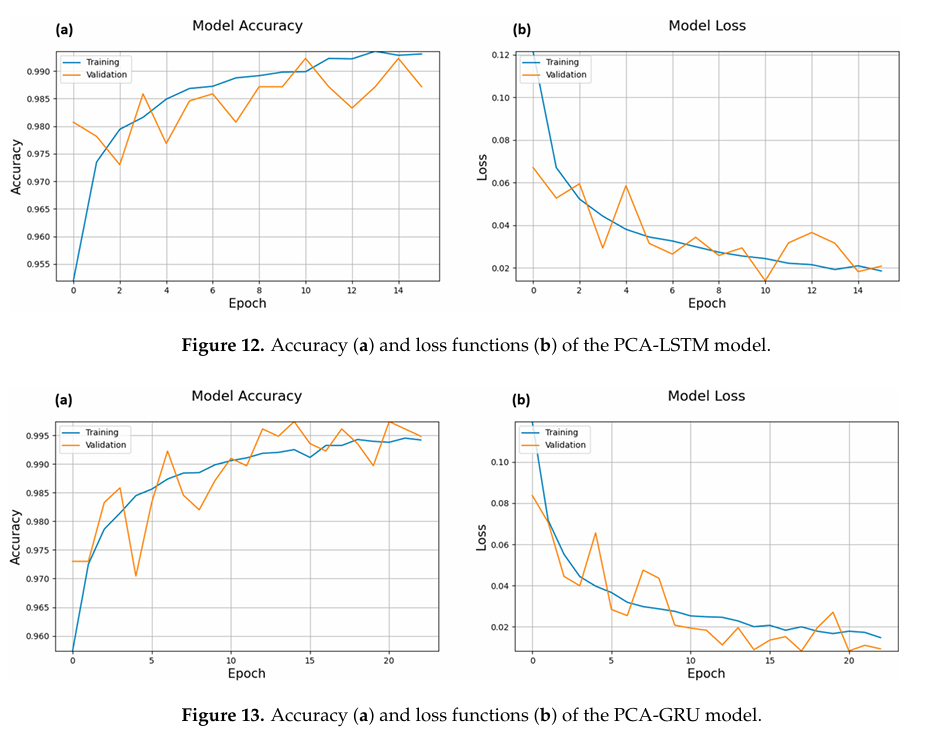
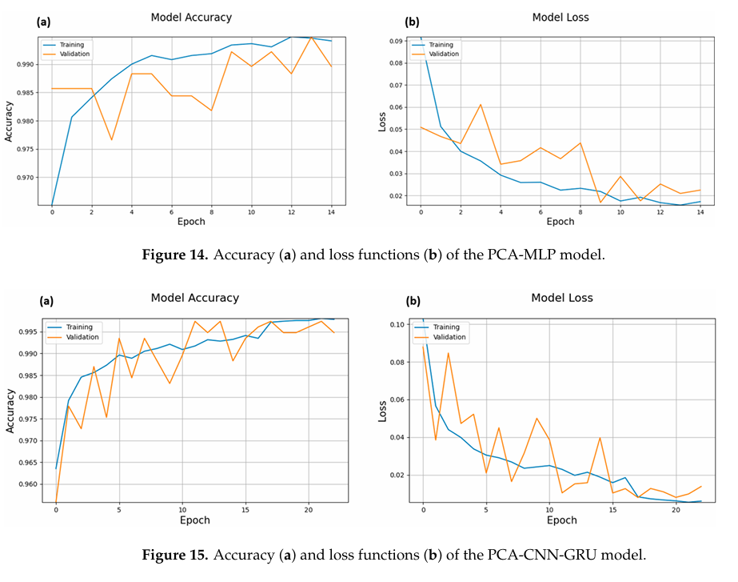
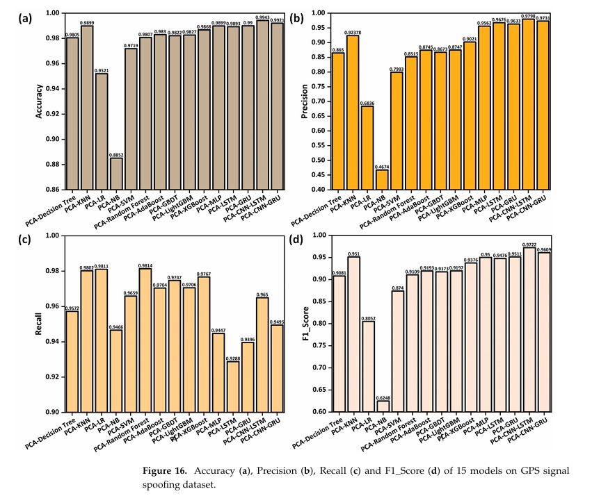
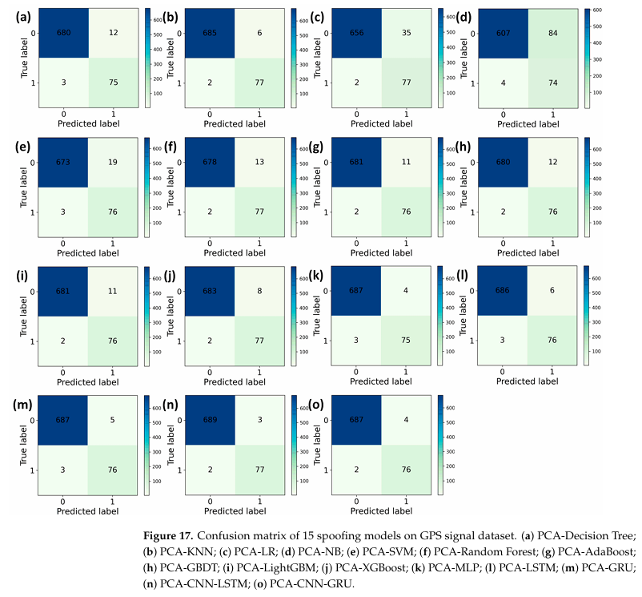

<!-- PAYMENT_BLOCK -->

## Get this dataset

- Payment link (Stripe): [Buy now](https://buy.stripe.com/3cs8yP7sY87d0vu9AB)
- Payment QR code: 

<!-- /PAYMENT_BLOCK -->
